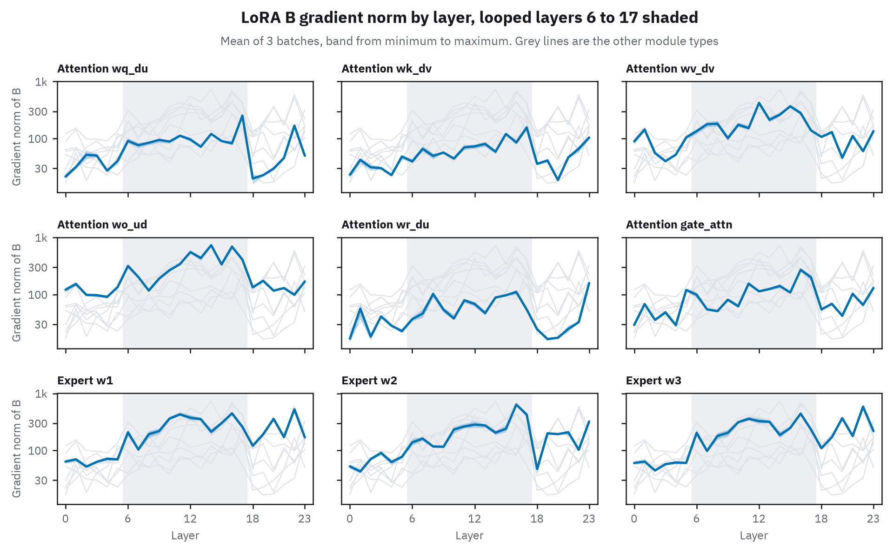

# 04. Gradient readout probe

Scripts 03 (Tinker) and 07 (analysis), outputs in `artifacts/grad_readout/`.

**Result.** One large-eps AdamW step recovers LoRA gradients to about 8%. On three small batches the looped layers 6 to 17 carry 1.5 to 3.1 times the B-gradient norm of the unlooped layers, by module type. The profile drops sharply at 17 to 18 in 8 of 9 module types and rises at 5 to 6 in only some. This suggests a loop effect in H1's range without ruling out depth effects that sit at the boundaries.

## Method

At LoRA init $B = 0$, so only $B$ moves in the first step. Adam's bias-corrected first step per entry is
$$\Delta B = -\eta \, \frac{g}{|g| + \epsilon},$$
with gradient $g$, learning rate $\eta$ and Adam's $\epsilon$. With $u = |\Delta B| / \eta$ the exact inverse is
$$|g| = \frac{\epsilon \, u}{1 - u}, \qquad \operatorname{sign}(g) = -\operatorname{sign}(\Delta B).$$
Each setting used a fresh rank-2 client (seed 0) and exported the adapter before and after the step. Each batch is 8 pointer-chasing prompts (6 letters, 1 to 3 hops, one-letter answer), 416 tokens with 40 supervised. The summed loss was about 370 (9.2 nats per supervised token). Per-layer runs used $\eta = \epsilon = 10^3$ on data seeds 0, 1 and 2 with the same random $A$.

With $G_l$ the Frobenius norm of the B gradient at layer $l$, script 03 reports per module type

- `ratio`, the mean of $G_{6..17}$ over the mean of $G_{0..5}$ and $G_{18..23}$ pooled,
- `j6` $= G_6 / G_5$ and `j18` $= G_{18} / G_{17}$.

## Validation

| Check | Value |
|---|---|
| Largest $\lvert g \rvert$ (same at $\epsilon = 1, 10^3, 10^4$) | 599.0 |
| $\epsilon = 1$ against $10^3$, relative error, linear readout | 0.88 |
| Same, exact inverse | 0.081 |
| $\epsilon = 10^3$ against $10^4$, exact inverse | 0.076 |
| Loss weights doubled, ratio of gradient norms | 2.012 |
| Sign agreement with the default sign step ($\eta = 10^{-3}$) | 96.9% |
| Share of $g^2$ in entries whose sign disagrees | 0.011% |
| Per-tensor norm ratio across clients, range | 0.937 to 1.039 |
| Fraction of B entries that moved | 74.8% |

All rows use data seed 0. At $\lvert g \rvert$ up to 599, $\epsilon = 1$ needs the exact inverse. Per-tensor norms repeat to within 6.3% across clients.

## Rate limit

The first run stalled over 15 minutes with the SDK warning "concurrent training clients rate limit hit" because each `ServiceClient` stayed open. With `sc.close()` later clients took 89 to 162 seconds and no warning appeared. The stall is a hand-written note in `run_log.json`, not a captured log line.

## Per-layer results

Ranges are over 3 seeds. "Ordinary ≥" counts the non-boundary adjacent steps (of 20) at least as large in log size. "Offset" is $e^{c}$ from fitting $\log G_l = a + b\,l + c\,\mathbb{1}[6 \le l \le 17]$ to seed means, with a 95% interval.

| Module | ratio | loop/prelude | loop/coda | j6 | ordinary ≥ j6 | j18 | ordinary ≥ j18 | Offset |
|---|---|---|---|---|---|---|---|---|
| wq_du | 2.21–2.28 | 2.68–2.99 | 1.81–1.98 | 2.10–2.40 | 3 | 0.07–0.09 | 0 | 2.6 (1.7–3.8) |
| wk_dv | 1.64–1.89 | 2.24–2.29 | 1.29–1.61 | 0.74–0.87 | 16 | 0.20–0.26 | 0 | 1.8 (1.3–2.5) |
| wv_dv | 2.33–2.54 | 2.68–2.69 | 2.06–2.40 | 1.23–1.33 | 17 | 0.76–0.79 | 17 | 2.4 (1.7–3.5) |
| wo_ud | 2.98–3.12 | 3.29–3.33 | 2.71–2.96 | 2.20–2.45 | 0 | 0.31–0.34 | 0 | 2.7 (2.0–3.8) |
| wr_du | 1.72–1.90 | 2.13–2.41 | 1.39–1.67 | 1.60–1.64 | 9 | 0.44–0.47 | 4 | 2.2 (1.4–3.4) |
| gate_attn | 1.79–1.91 | 2.16–2.26 | 1.52–1.68 | 0.75–0.87 | 18 | 0.25–0.32 | 1 | 1.8 (1.3–2.7) |
| experts.w1 | 1.74–1.89 | 4.35–4.59 | 1.09–1.19 | 2.73–3.30 | 2 | 0.42–0.51 | 2 | 2.2 (1.6–3.0) |
| experts.w2 | 1.97–2.22 | 3.86–3.94 | 1.33–1.54 | 1.67–2.01 | 5 | 0.10–0.12 | 0 | 2.3 (1.6–3.3) |
| experts.w3 | 1.52–1.65 | 4.36–4.64 | 0.92–1.00 | 3.08–3.73 | 0 | 0.44–0.51 | 3 | 2.1 (1.5–2.9) |

Per-layer seed spread is mostly 5% to 25% (full table in `per_layer_table.csv`). `lm_head` (879 to 908) is excluded.

## Interpretation

The drop at 17 to 18 holds in every seed and, except for wv_dv, is larger than at least 16 of the 20 ordinary steps. A smooth depth trend would not do this. Part of it is a peak at layers 16 and 17, since the looped block rises along its length instead of forming a plateau.

The rise at 5 to 6 is clear for wq_du, wo_ud, w1 and w3 and absent for wk_dv, wv_dv and gate_attn.

The pooled `ratio` hides that prelude and coda differ. Expert tensors owe their ratio mostly to a low prelude (w3 loop/coda is 0.92 to 1.00). With a linear depth trend removed, the offset is 1.8 to 2.7 and every interval excludes 1. With a quadratic trend the intervals widen (lower ends 1.0 to 2.1, upper 4.1 to 8.6). The data fit H1's range of 1 to 3 but cannot pin the factor or attribute it to looping alone.

## Limits

- One task, one batch size, one $A$ init, three batches.
- A B-gradient norm is a first-order loss sensitivity, while H1 concerns output change. Activation scales also differ by layer.
- The looped gradient sums the 3 passes, so it cannot show how open the cross-pass gates are.
- Expert gradients come only from routed experts (w1 and w3 have a B per expert, w2 a shared B). Three passes may reach more experts, which the saved norms cannot test.
- At 9.2 nats per supervised token, format tokens may dominate the gradient.
