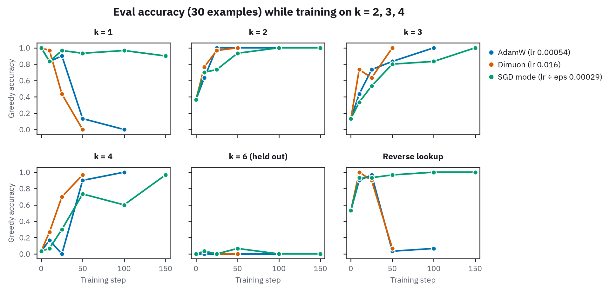
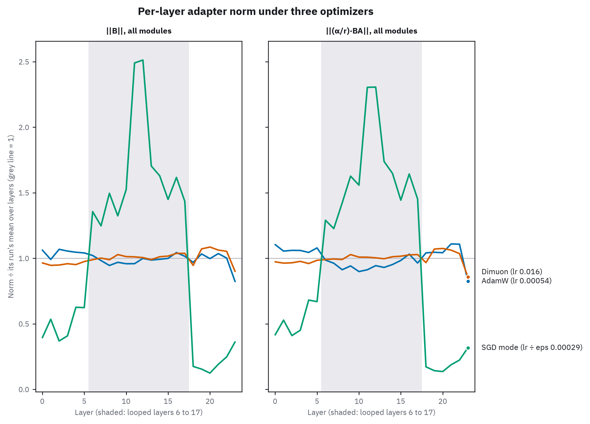

# 10. E2 pilot, AdamW in SGD mode

With Adam's $\epsilon$ far above every gradient entry, AdamW becomes SGD with momentum. Its trained adapter keeps the initial gradient's shape, with a looped share of 0.95 against about 0.5 for AdamW and Dimuon. The best run learned $k = 2, 3, 4$ in 150 steps and, unlike the other two, kept $k=1$ and reverse lookup. Effective rates of $5 \times 10^{-4}$ and above collapsed within the first update. With one run per setting, this is suggestive. Code is in `scripts/11_e2_pilot_sgd.py`, outputs in `artifacts/e2_pilot/sgd_*/`.

## SGD mode

Adam updates by $\Delta\theta = -\eta\, \hat m / (\sqrt{\hat v} + \epsilon)$. When $\sqrt{\hat v} \ll \epsilon$,
$$\Delta\theta \approx -\frac{\eta}{\epsilon}\, \hat m,$$
which is SGD with EMA momentum $\beta_1 = 0.9$ at rate $\eta_{\text{eff}} = \eta/\epsilon$. Runs use $\epsilon = 10^4$, $\eta = 10^4 \eta_{\text{eff}}$, weight decay 0, and otherwise the setup of note 09. Tinker accepted them.

**The regime holds at step 1.** From $B = 0$ the first step is exactly $|\Delta B| = \eta |g|/(|g|+\epsilon)$, so an entry falls short of the linear step by the fraction $u = |\Delta B|/\eta$. The largest $u$ was 0.006 in every run ($|g| \approx 60$). Since $\sqrt{\hat v_t} \le \max_{s \le t} |g_s|$, entries up to 600 would stay within 6% of linear. Later gradients were not logged.

## Choosing the rate

AdamW's first step is a sign step, with norm $5.71 \times 0.54 = 3.08$ at $5.4 \times 10^{-4}$ (note 02 measured 5.71 at $10^{-3}$). The SGD-mode first step has norm $\eta_{\text{eff}} \lVert g \rVert$. E0 (rank 2) gave gradient norms of 2787, 4191 and 3234 for $k = 2, 3, 4$. A mixed batch takes a third of each, giving 1994 if orthogonal and 3404 if aligned. Rank 8 has $\alpha/r$ four times smaller and four times as many columns of $B$, which halves this to 1000 to 1700. The smoke test at $2 \times 10^{-3}$ measured 2015, so the prior was low, and the matched rate is $3.08/2015 = 1.5 \times 10^{-3}$.

## Rates tried

"Collapsed" means that after one update the loss sat near $\ln 26 = 3.26$ (uniform over the 26 letters) for every $k$, and eval accuracy fell to chance, $1/26$. The loss never blew up (at most 4.69 after step 1).

| $\eta_{\text{eff}}$ | Step-1 norm | Loss at step 2 | Outcome |
|---|---|---|---|
| $2 \times 10^{-3}$ (smoke, 5 steps) | 4.03 | 3.54 | collapsed |
| $1.5 \times 10^{-3}$ | 3.00 | 3.45 | collapsed, at chance through step 150 |
| $5 \times 10^{-4}$ | 1.01 | 3.40 | collapsed, interrupted at step 16 |
| $2.9 \times 10^{-4}$ | 0.59 | 3.04 | passed the bar at step 150 |
| $1.7 \times 10^{-4}$ | 0.35 | 2.78 | learned, $k=3$ at 0.93 at step 150 |

The SGD run below is $2.9 \times 10^{-4}$, added last to narrow the edge.

## Accuracy

| Step | Optimizer | $k=1$ | $k=2$ | $k=3$ | $k=4$ | $k=6$ | Reverse |
|---|---|---|---|---|---|---|---|
| 0 | all | 1.00 | 0.37 | 0.13 | 0.03 | 0.00 | 0.53 |
| 10 | AdamW / Dimuon / SGD | 0.83 / 0.97 / 0.83 | 0.63 / 0.77 / 0.70 | 0.43 / 0.73 / 0.33 | 0.17 / 0.27 / 0.07 | 0.00 / 0.03 / 0.03 | 0.90 / 1.00 / 0.93 |
| 50 | AdamW / Dimuon / SGD | 0.13 / 0.00 / 0.93 | 1.00 / 1.00 / 0.93 | 0.83 / 1.00 / 0.80 | 0.90 / 0.97 / 0.73 | 0.00 / 0.00 / 0.07 | 0.03 / 0.07 / 0.97 |
| 100 | AdamW / SGD | 0.00 / 0.97 | 1.00 / 1.00 | 1.00 / 0.83 | 1.00 / 0.60 | 0.00 / 0.00 | 0.07 / 1.00 |
| 150 | SGD | 0.90 | 1.00 | 1.00 | 0.97 | 0.00 | 1.00 |

At the final step SGD mode applies one hop on $k=1$ (27 of 30) and inverts correctly on reverse (30 of 30). AdamW and Dimuon apply two hops on both (26 to 28 of 30). All three apply four hops on $k=6$ in 30 of 30.

## Where the adapter sits

$S$ is the looped share of squared norm and $R$ the looped over unlooped mean per-layer norm (note 09). "Effective" means $\frac{\alpha}{r} BA$.

| Quantity | Group | $S$ AdamW | $S$ Dimuon | $S$ SGD | $R$ AdamW | $R$ Dimuon | $R$ SGD |
|---|---|---|---|---|---|---|---|
| $B$ | all | 0.489 | 0.510 | 0.950 | 0.98 | 1.02 | 4.70 |
| $B$ | attention | 0.470 | 0.494 | 0.950 | 0.94 | 0.99 | 4.63 |
| $B$ | MLP experts | 0.489 | 0.511 | 0.949 | 0.98 | 1.02 | 4.88 |
| effective | all | 0.451 | 0.508 | 0.944 | 0.91 | 1.02 | 4.53 |
| effective | attention | 0.447 | 0.491 | 0.951 | 0.90 | 0.98 | 4.67 |
| effective | MLP experts | 0.451 | 0.509 | 0.937 | 0.91 | 1.02 | 4.45 |

| All modules | AdamW | Dimuon | SGD |
|---|---|---|---|
| $B$, layer 6 / layer 5 | 0.98 | 1.01 | 2.17 |
| $B$, layer 18 / layer 17 | 0.95 | 0.91 | 0.12 |
| Effective, layer 6 / layer 5 | 0.91 | 1.01 | 1.93 |
| Effective, layer 18 / layer 17 | 1.08 | 0.94 | 0.12 |
| Cosine of final $B$ profile with step-1 profile | 0.819 | 0.826 | 0.997 |
| $\lVert B \rVert_F$, 24 layers | 36.2 | 57.2 | 2.12 |

The SGD step-1 update had $S = 0.942$, close to E0's 0.95.

## What it suggests

- The layer profile depends on the optimizer. SGD mode keeps the gradient profile, while AdamW and Dimuon flatten it, and all three learn the task. But SGD mode also moved much less, which keeps any profile near the gradient, and a low-rate AdamW control would separate the two. Profile tests of H3 (deeper tasks put more weight in looped layers) are confounded by the optimizer.
- SGD mode kept $k=1$ and reverse, but its $B$ is 17 to 27 times smaller. Staying near initialisation could explain this as well as placement could.
- Collapse followed the first update, a plain gradient step, with the edge between step norms 0.59 and 1.01 (0.19 to 0.33 of AdamW's). At $5 \times 10^{-4}$ the largest entry moves about 55 times AdamW's per-entry step. This fits H2 (the looped layers set the largest stable rate) but does not test it.

## Limits

- One seed per setting.
- Unequal training (100, 50 and 150 steps). All AdamW runs used weight decay 0.
- Linearity is checked at step 1 only.
- The edge depends on how collapse is defined.
- 30 eval examples per condition (standard error at most 0.09).
