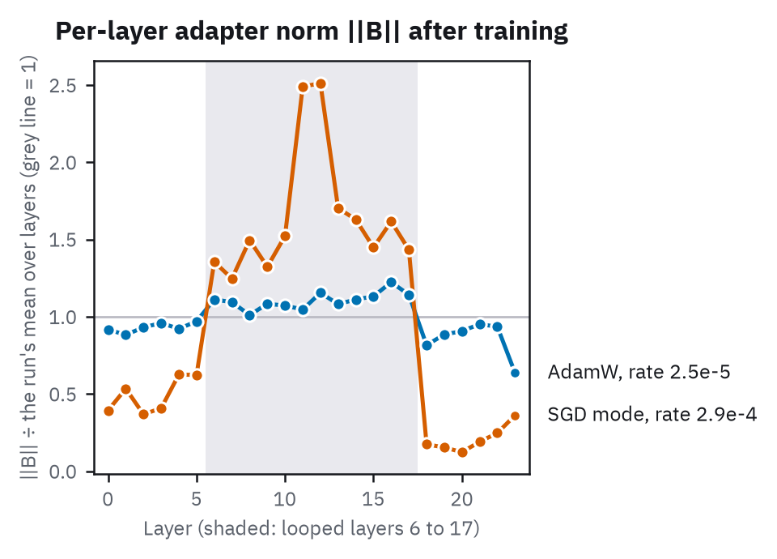

# 11. Controls for the SGD-mode pilot

Turning off the unembedding adapter did not move the SGD-mode stability edge. With and without it, $\eta_{\text{eff}} = 5 \times 10^{-4}$ starts learning within 30 steps, while $8.7 \times 10^{-4}$ and $1.5 \times 10^{-3}$ fall to chance, so the edge lies between $5 \times 10^{-4}$ and $8.7 \times 10^{-4}$ in both. Note 10's $5 \times 10^{-4}$ run was stopped at step 16 on a loss plateau that both new runs left. A low-rate AdamW adapter with movement close to SGD mode's is still nearly flat ($S = 0.60$) and half clamps hops. $k=1$ fell to 0.33, but reverse lookup survived at 0.87. One run per setting, so this is suggestive. Code is in `scripts/12_controls.py`, outputs in `artifacts/e2_controls/`.

## Control 1, the stability edge

Probes reuse note 10's setup ($\epsilon = 10^4$) for 30 steps without early stop. With `train_unembed=False` the exports hold no `lm_head` tensors. A run counts as collapsed when every condition's accuracy at its last eval is at most 0.11 (chance plus two standard errors) and its loss over the last 5 steps averages within 0.5 of $\ln 26 = 3.26$.

| Modules | $\eta_{\text{eff}}$ | Steps | Loss, step 2 | Loss, last 5 | Best accuracy, last eval | Outcome |
|---|---|---|---|---|---|---|
| all (note 10) | $2.9 \times 10^{-4}$ | 150 | 3.04 | 0.04 | 1.00 | learned |
| all (note 10) | $5 \times 10^{-4}$ | 16 | 3.40 | 3.50 | 0.07 | stopped on plateau |
| all | $5 \times 10^{-4}$ | 30 | 3.37 | 3.00 | 0.70 | leaving plateau |
| no unembedding | $5 \times 10^{-4}$ | 30 | 3.40 | 0.89 | 0.93 | learned |
| all | $8.7 \times 10^{-4}$ | 30 | 3.43 | 3.29 | 0.07 | collapsed |
| no unembedding | $8.7 \times 10^{-4}$ | 30 | 3.40 | 3.29 | 0.10 | collapsed |
| all (note 10) | $1.5 \times 10^{-3}$ | 150 | 3.45 | 3.25 | 0.07 | collapsed |
| no unembedding | $1.5 \times 10^{-3}$ | 30 | 3.45 | 3.29 | 0.03 | collapsed |

Accuracy at step 30 for the two $5 \times 10^{-4}$ runs.

| Modules | $k=1$ | $k=2$ | $k=3$ | $k=4$ | $k=6$ | Reverse |
|---|---|---|---|---|---|---|
| all | 0.70 | 0.47 | 0.03 | 0.00 | 0.00 | 0.27 |
| no unembedding | 0.83 | 0.93 | 0.70 | 0.67 | 0.13 | 0.93 |

At $5 \times 10^{-4}$ the unembedding only lengthened the plateau. Without it the loss stayed below 2.5 from step 18. With it accuracy sat at chance at steps 10 and 20 and the loss was 2.69 at step 30. The runs part at step 8, when the loss jumped to 4.33 with the unembedding and 3.56 without.

The step-1 exports also contradict the premise that `lm_head` has the largest gradient entries. Its largest update entry is a quarter of the largest layer entry (0.0069 against 0.030 at $5 \times 10^{-4}$), which sits in a looped expert (layer 14, `w3`, gradient about 61). Later gradients were not logged. The attention-only and experts-only probes were planned for the case where both rates still collapsed, so they were not run.

## Control 2, AdamW at a small total movement

AdamW's step scales with lr, and the 100-step run at $5.4 \times 10^{-4}$ ended at $\lVert B \rVert_F = 36.2$. Scaling gives $36.2 \times 2.5 \times 10^{-5} / 5.4 \times 10^{-4} = 1.68$ at 100 steps. Over 150 steps that becomes $1.68\sqrt{1.5} = 2.05$ if movement grows like a random walk, or $1.68 \times 1.5 = 2.51$ if it grows linearly. I ran $2.5 \times 10^{-5}$ with default $\epsilon$. The final norm was 2.82, 1.4 times the target and within the factor-2 limit.

| Step | $k=1$ | $k=2$ | $k=3$ | $k=4$ | $k=6$ | Reverse |
|---|---|---|---|---|---|---|
| 0 | 1.00 | 0.37 | 0.13 | 0.03 | 0.00 | 0.53 |
| 10 | 1.00 | 0.73 | 0.07 | 0.00 | 0.00 | 0.63 |
| 25 | 0.93 | 0.87 | 0.27 | 0.07 | 0.03 | 0.90 |
| 50 | 0.90 | 0.93 | 0.70 | 0.17 | 0.03 | 0.87 |
| 100 | 0.50 | 1.00 | 1.00 | 0.90 | 0.03 | 0.90 |
| 150 | 0.33 | 1.00 | 0.97 | 0.93 | 0.00 | 0.87 |

At step 150 it applies two hops on $k=1$ in 20 of 30 cases, four on $k=6$ in 28 of 30, and inverts reverse correctly in 26 of 30. When $k=4$ first reached 0.90, the $5.4 \times 10^{-4}$ run (step 50) had $k=1$ at 0.13 and reverse at 0.03, while the low rate (step 100) had 0.50 and 0.90.

## Four optimizers

The cosine compares each run's 24-layer $B$-norm profile with the step-1 gradient profile (note 10). The low-rate AdamW step-1 update already had $S = 0.508$.

| Run | Steps | $\lVert B \rVert_F$ | $S$ | $R$ | L6/L5 | L18/L17 | Cosine | $k=1$ | $k=2$ | $k=3$ | $k=4$ | $k=6$ | Reverse |
|---|---|---|---|---|---|---|---|---|---|---|---|---|---|
| AdamW $5.4 \times 10^{-4}$ | 100 | 36.2 | 0.489 | 0.98 | 0.98 | 0.95 | 0.819 | 0.00 | 1.00 | 1.00 | 1.00 | 0.00 | 0.07 |
| AdamW $2.5 \times 10^{-5}$ | 150 | 2.82 | 0.603 | 1.24 | 1.15 | 0.71 | 0.874 | 0.33 | 1.00 | 0.97 | 0.93 | 0.00 | 0.87 |
| Dimuon $1.6 \times 10^{-2}$ | 50 | 57.2 | 0.510 | 1.02 | 1.01 | 0.91 | 0.826 | 0.00 | 1.00 | 1.00 | 0.97 | 0.00 | 0.07 |
| SGD mode $2.9 \times 10^{-4}$ | 150 | 2.12 | 0.950 | 4.70 | 2.17 | 0.12 | 0.997 | 0.90 | 1.00 | 1.00 | 0.97 | 0.00 | 1.00 |

## What this shows and does not show

- The unembedding does not set the edge to within the grid's factor of 1.74. A smaller shift would go unseen, and which modules set the edge is open.
- The flat profile appears to come from AdamW's per-entry scaling rather than large movement, since it is flat from step 1.
- Small movement kept reverse lookup and slowed the loss of $k=1$, so movement explains part of note 09's forgetting. SGD mode kept $k=1$ at 0.90 with similar movement, which points to placement or update direction for the rest.

## Limits

- One seed per setting. Repeated runs are not bit-identical (about 1% apart at step 2).
- 30-step probes cannot tell a long plateau from a collapse.
- 30 eval examples per condition. No rate limits, SDK warnings or API errors were logged.
