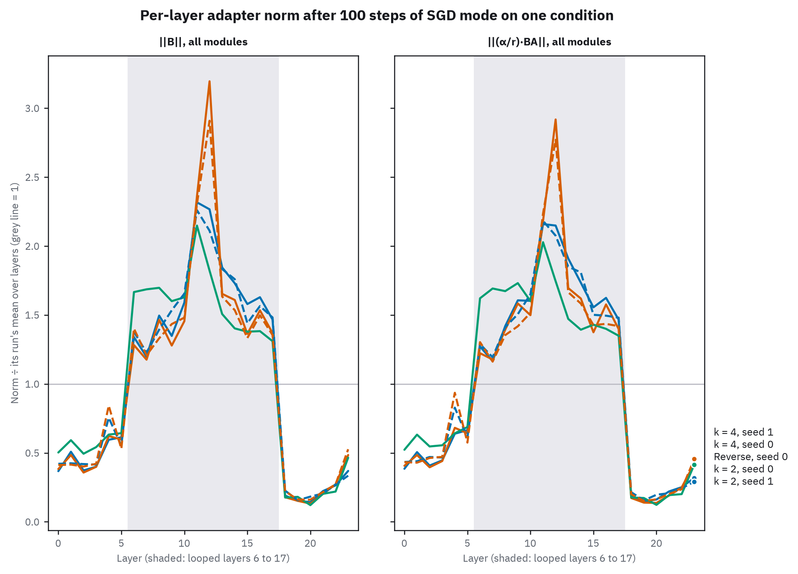
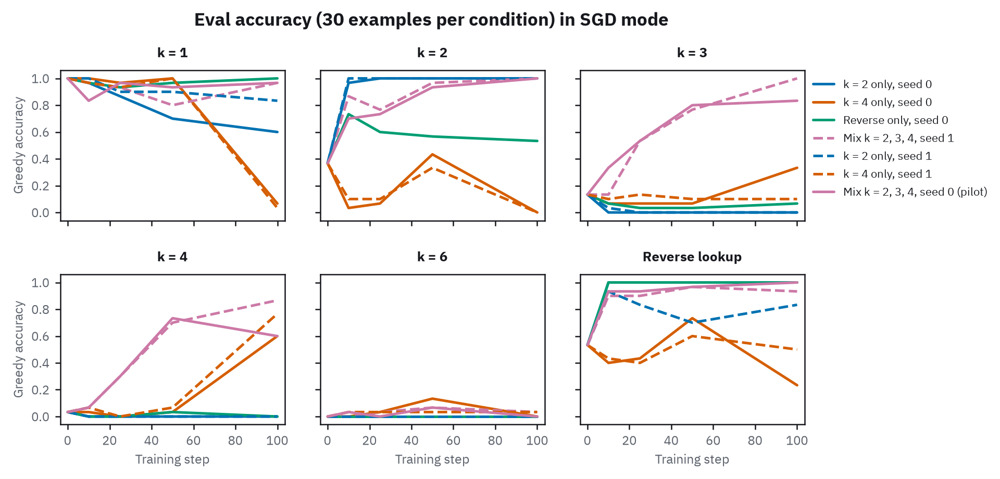

# 12. E2 single-condition runs in SGD mode (H3), partial

H3 cannot be decided from these runs. Training on $k=2$ only and $k=4$ only put the same looped share in the adapter ($S = 0.951$ and $0.952$), against $0.931$ for reverse only. H3 predicts $S(k{=}4) > S(k{=}2) > S(\text{reverse})$. The first gap is $0.0008$, so these runs show no hop-count effect between $k=2$ and $k=4$. The second gap ($0.020$) points the predicted way but already appears in the step-1 update, and there is no seed-to-seed estimate to judge it against. The seed-1 runs did not finish (see Seed replication). Code is in `scripts/13_e2_single_condition.py`, outputs in `artifacts/e2_single/`.

## Setup

SGD mode per note 10 ($\epsilon = 10^4$, $\eta_{\text{eff}} = 2.9 \times 10^{-4}$), rank 8, batch 32, LoRA seed 0, data seed 1, weight decay 0, fixed 100 steps with early stop off. $S$ is the share of squared norm in layers 6 to 17, $R$ the mean looped over mean unlooped per-layer norm, "effective" means $\frac{\alpha}{r} BA$. No run sat at chance for all 100 steps, so no run was repeated at $1.7 \times 10^{-4}$. The $k=4$ run stayed near $\ln 26$ (loss 3.10 to 3.25) up to step 50 and fell to 0.95 by step 100.

## Where the adapter sits

| Run | $S_B$ | $S_{\text{eff}}$ | $R_B$ | $R_{\text{eff}}$ | $B$ L6/L5 | $B$ L18/L17 | Peak layer | $\lVert B \rVert_F$ | $S_B$ at step 1 |
|---|---|---|---|---|---|---|---|---|---|
| $k=2$ only | 0.951 | 0.946 | 4.72 | 4.54 | 2.19 | 0.13 | 11 | 1.13 | 0.940 |
| $k=4$ only | 0.952 | 0.946 | 4.63 | 4.50 | 2.15 | 0.13 | 12 | 1.66 | 0.943 |
| Reverse only | 0.931 | 0.926 | 4.03 | 3.93 | 2.59 | 0.13 | 11 | 0.53 | 0.930 |
| Pilot mix (150 steps) | 0.950 | 0.944 | 4.70 | 4.53 | 2.17 | 0.12 | 12 | 2.12 | 0.942 |

Attention and MLP experts agree to within 0.02 of the "all" value in every run (table in `single_tables.json`).

Share of squared $B$ norm by block. The loop columns are shares of the looped total, so they show where weight sits inside the loop.

| Run | Prelude 0 to 5 | Coda 18 to 23 | Loop 6 to 9 | Loop 10 to 13 | Loop 14 to 17 | Loop centroid |
|---|---|---|---|---|---|---|
| $k=2$ only | 0.040 | 0.009 | 0.214 | 0.483 | 0.303 | 11.87 |
| $k=4$ only | 0.037 | 0.011 | 0.188 | 0.571 | 0.240 | 11.78 |
| Reverse only | 0.058 | 0.011 | 0.352 | 0.409 | 0.239 | 10.99 |
| Pilot mix | 0.042 | 0.008 | 0.214 | 0.513 | 0.273 | 11.75 |

Cosines between 24-layer $B$ profiles are 0.987 ($k=2$, $k=4$), 0.985 ($k=2$, reverse), 0.964 ($k=4$, reverse) and 0.998 ($k=2$, pilot).

## Differences, with the noise they need

| Difference | $\Delta S_B$ | $\Delta$ share of loop in 10 to 13 | $\Delta$ share of loop in 6 to 9 |
|---|---|---|---|
| $k=4$ minus $k=2$ | +0.001 | +0.088 | −0.026 |
| $k=2$ minus reverse | +0.020 | +0.074 | −0.138 |
| $k=4$ minus reverse | +0.021 | +0.162 | −0.164 |
| Seed 1 minus seed 0, any condition | not measured | not measured | not measured |

Without a seed spread none of these can be called real. The reverse gaps are already in the step-1 update ($S = 0.930$ against 0.940 and 0.943, loop 6 to 9 share 0.35 against 0.22 and 0.25), so they describe the gradient at initialisation more than what training added. The $k=4$ shift toward layers 10 to 13 grew during training. At step 1 its middle-third share was 0.47, the same as $k=2$, and its final profile has cosine 0.985 with its step-1 profile against 0.999 for $k=2$ and reverse.

## Accuracy and hops applied

| Run, step 100 | $k=1$ | $k=2$ | $k=3$ | $k=4$ | $k=6$ | Reverse |
|---|---|---|---|---|---|---|
| $k=2$ only | 0.60 | 1.00 | 0.00 | 0.00 | 0.00 | 1.00 |
| $k=4$ only | 0.07 | 0.00 | 0.33 | 0.60 | 0.00 | 0.23 |
| Reverse only | 1.00 | 0.53 | 0.07 | 0.00 | 0.00 | 1.00 |
| Pilot mix | 0.97 | 1.00 | 0.83 | 0.60 | 0.00 | 1.00 |

Each run applies a hop count close to the one it trained on. The $k=2$ adapter applies two hops on 30 of 30 prompts for $k = 3$ and $k = 4$, 29 of 30 for $k=6$, and 12 of 30 for $k=1$, while it inverts reverse in 30 of 30. The $k=4$ adapter applies 3 to 5 hops on 30 of 30 prompts at $k = 2, 3, 4$ and $6$, applies two hops on 21 of 30 at $k=1$, and answers reverse with the forward image in 23 of 30. The reverse adapter keeps $k=1$ and reverse at 30 of 30 and applies one or two hops on the deeper conditions.

## Seed replication

Not available. The seed-1 mix run was stopped at step 65 when its background job hit the time limit. At step 50 it scored 0.80, 0.97, 0.77, 0.70, 0.07, 0.97 on $k = 1, 2, 3, 4, 6$ and reverse, against 0.93, 0.93, 0.80, 0.73, 0.07, 0.97 for the pilot. The two differ by at most 0.04 except at $k=1$ (0.13). Whether $S = 0.95$ replicates is open, because its final adapter was never exported.

## Limits

- One seed per condition. The adapters moved different distances ($\lVert B \rVert_F$ from 0.53 to 1.66).
- 30 eval examples per condition (standard error at most 0.09).
- No API errors, rate limits or SDK warnings were logged in the three finished runs.

## Update 2026-11-28, LoRA seed 1 runs

The resumed chain finished the three seed 1 runs. The table and differences below come from `scripts/13_e2_single_condition.py analyze` and are stored in `artifacts/e2_single/single_tables.json`.

| Run (seed 1, 100 steps) | $S$ | $R$ | L6/L5 | L18/L17 | Peak | $\lVert B\rVert_F$ | Final accuracy k1, k2, k3, k4, k6, reverse |
|---|---|---|---|---|---|---|---|
| mix of k = 2, 3, 4 | 0.942 | 4.42 | 2.59 | 0.15 | 11 | 1.93 | 0.97, 1.00, 1.00, 0.87, 0.03, 0.93 |
| k = 2 only | 0.945 | 4.51 | 2.50 | 0.15 | 11 | 1.08 | 0.83, 1.00, 0.00, 0.00, 0.00, 0.83 |
| k = 4 only | 0.940 | 4.24 | 2.64 | 0.16 | 12 | 1.47 | 0.03, 0.00, 0.10, 0.77, 0.03, 0.50 |

| Difference | $\Delta S$ | $\Delta$ share of loop in layers 10 to 13 |
|---|---|---|
| k = 4 minus k = 2, seed 0 | +0.0008 | +0.088 |
| k = 4 minus k = 2, seed 1 | -0.0052 | +0.075 |
| seed 1 minus seed 0, k = 2 | -0.0054 | -0.011 |
| seed 1 minus seed 0, k = 4 | -0.0114 | -0.025 |
| seed 1 mix (100 steps) minus pilot (150 steps) | -0.0082 | -0.007 |

What this adds.

- The pilot replicates with a second LoRA seed. The looped share is 0.942 against 0.950, and k = 1 and reverse stay at 0.97 and 0.93.
- H3 in its main form fails on two seeds. The k = 4 minus k = 2 difference in $S$ is +0.0008 and -0.0052. The seed to seed differences are as large or larger (0.005 to 0.011).
- The shift inside the loop replicates. A k = 4 adapter puts 0.075 to 0.088 more of its looped weight in layers 10 to 13 than a k = 2 adapter. The seed to seed differences in that share are 0.011 and 0.025. Two seeds suggest the shift is real. They do not establish it.
- Each single condition adapter again applies a fixed hop count. The seed 1 k = 2 adapter takes two hops on 30 of 30 prompts at k = 3 and k = 4. The seed 1 k = 4 adapter takes four or five hops on 30 of 30 prompts at k = 4.

Limits. Two seeds per condition, 30 eval examples, and the k = 4 adapters are not finished learning at step 100 (0.60 and 0.77 on k = 4).
