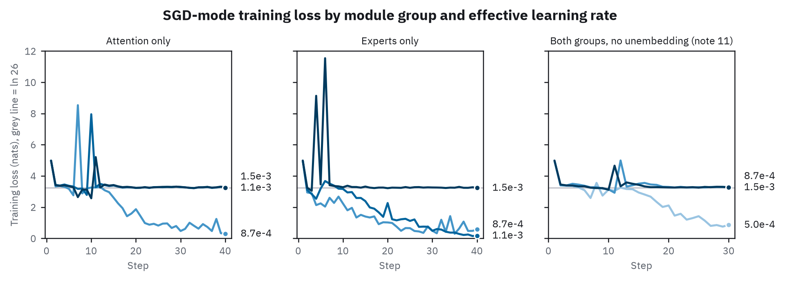
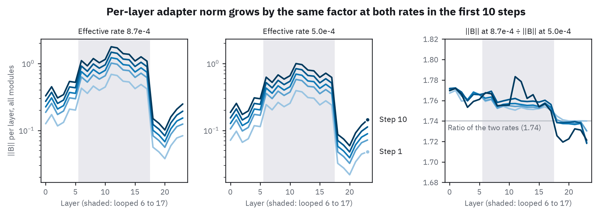

# 13. Stability edge by module group

Attention has the lower SGD-mode edge. Trained alone, attention learns at $\eta_{\text{eff}} = 8.7 \times 10^{-4}$ and collapses at $1.1 \times 10^{-3}$. Experts alone learn at $1.1 \times 10^{-3}$ and collapse at $1.5 \times 10^{-3}$, so their edge is higher by a factor between 1 and 1.72. Both sit above the edge with both groups trained, between $5 \times 10^{-4}$ and $8.7 \times 10^{-4}$ (note 11). In first-update norm all three edges fit one threshold between 1.29 and 1.64. In an all-modules run, no layer range grows faster at the collapsing rate during the first 10 steps. One run per setting, so this suggests. Code is in `scripts/14_edge_by_module.py`, outputs in `artifacts/e2_edge/`.

## Setup

Runs use SGD mode as in note 10 ($\epsilon = 10^4$, rank 8, LoRA seed 0, data seed 1). Part A probes run 40 steps with the unembedding off. Evals cover six conditions ($k = 1, 2, 3, 4, 6$ and reverse lookup, 30 examples each). A probe has collapsed when every condition is at or below 0.11 at the last eval and the loss is within 0.5 of $\ln 26 = 3.26$ over the last 5 steps on average and on each of the last 25 steps. Step-1 exports hold only the trained group. $\lVert \Delta B_1 \rVert_F$ is the norm of the first update over the 24 layers. I added $1.1 \times 10^{-3}$ to the planned grid because both groups learned at $8.7 \times 10^{-4}$ and collapsed at $1.5 \times 10^{-3}$. The loss at step $t$ is computed before update $t$.

## Part A, edge by module group

| Group | $\eta_{\text{eff}}$ | $\lVert \Delta B_1 \rVert_F$ | Peak loss (step) | Loss, last 5 | Best accuracy at 10 / 20 / 40 | Outcome |
|---|---|---|---|---|---|---|
| attention | $8.7 \times 10^{-4}$ | 1.29 | 8.53 (7) | 0.62 | 0.23 / 0.67 / 0.93 | learned |
| attention | $1.1 \times 10^{-3}$ | 1.64 | 7.95 (10) | 3.27 | 1.00 / 0.10 / 0.07 | collapsed |
| attention | $1.5 \times 10^{-3}$ | 2.24 | 5.21 (11) | 3.28 | 0.93 / 0.10 / 0.03 | collapsed |
| experts | $8.7 \times 10^{-4}$ | 1.03 | 2.94 (2) | 0.65 | 0.97 / 0.90 / 1.00 | learned |
| experts | $1.1 \times 10^{-3}$ | 1.29 | 3.67 (6) | 0.22 | 0.73 / 0.83 / 1.00 | learned |
| experts | $1.5 \times 10^{-3}$ | 1.78 | 11.54 (6) | 3.26 | 0.03 / 0.10 / 0.03 | collapsed |
| both (note 11) | $5 \times 10^{-4}$ | 1.01 | | 0.89 | | learned |
| both (note 11) | $8.7 \times 10^{-4}$ | 1.76 | | 3.29 | | collapsed |

"Best accuracy" is the highest over the six conditions. Every Part A collapse passes through a loss spike between steps 6 and 11 and then stays at $\ln 26$. The learning attention run at $8.7 \times 10^{-4}$ also spiked, to 8.53, and recovered. Per unit rate the attention gradient is 1.24 times the experts' (1.285 against 1.033 at $8.7 \times 10^{-4}$).

## Part B, anatomy of an all-modules collapse

Both runs train all modules for 10 steps. $S$ is the looped share of squared $B$ norm.

| Step | $\lVert B \rVert_F$ at $8.7 \times 10^{-4}$ | at $5 \times 10^{-4}$ | Ratio | $S$ at $8.7 \times 10^{-4}$ | $S$ at $5 \times 10^{-4}$ |
|---|---|---|---|---|---|
| 1 | 1.773 | 1.011 | 1.75 | 0.941 | 0.942 |
| 2 | 2.613 | 1.489 | 1.75 | 0.941 | 0.942 |
| 3 | 3.144 | 1.789 | 1.76 | 0.941 | 0.941 |
| 5 | 3.805 | 2.161 | 1.76 | 0.940 | 0.941 |
| 10 | 4.590 | 2.600 | 1.77 | 0.940 | 0.939 |

Growth from step 1 to step 10, $\lVert B(10) \rVert / \lVert B(1) \rVert$ over a layer range.

| Modules | Layers | $8.7 \times 10^{-4}$ | $5 \times 10^{-4}$ | Ratio |
|---|---|---|---|---|
| attention | 0 to 5 | 2.60 | 2.61 | 1.00 |
| attention | 6 to 17 | 2.59 | 2.56 | 1.01 |
| attention | 18 to 23 | 2.82 | 2.85 | 0.99 |
| experts | 0 to 5 | 2.60 | 2.60 | 1.00 |
| experts | 6 to 17 | 2.59 | 2.58 | 1.00 |
| experts | 18 to 23 | 2.65 | 2.66 | 1.00 |

Per layer the ratio of growths lies between 0.98 and 1.03 (largest, attention in layer 11). The higher rate scales the whole adapter by about 1.75 and changes nothing else visible in the norms.

The first update drops the loss from 4.98 to about 3.4 at both rates, close to the uniform guess at $\ln 26$. At $8.7 \times 10^{-4}$ it then stays between 3.22 and 3.51 with no oscillation. At $5 \times 10^{-4}$ it starts to fall unevenly (2.72, 3.28, 2.68, 3.08 at steps 7 to 10). In note 11's 30-step runs the spike before collapse came at steps 11 to 13, after this window.

| Step | 1 | 2 | 3 | 4 | 5 | 6 | 7 | 8 | 9 | 10 |
|---|---|---|---|---|---|---|---|---|---|---|
| $8.7 \times 10^{-4}$ | 4.98 | 3.40 | 3.41 | 3.51 | 3.45 | 3.37 | 3.28 | 3.33 | 3.23 | 3.22 |
| $5 \times 10^{-4}$ | 4.98 | 3.38 | 3.36 | 3.38 | 3.26 | 3.10 | 2.72 | 3.28 | 2.68 | 3.08 |

## What this says about H2

- Attention has the lower edge, by a factor between 1 and 1.72. The overlap in first-update norm fits a single threshold on total step size, which attention reaches at a lower rate and both groups together reach lower still.
- The norms give no layer-specific precursor of collapse in the first 10 steps. Later steps were not exported.
- This cannot separate looped from unlooped layers. Both groups put about 0.92 of their step-1 squared norm in looped layers. A group-level result cannot say whether the looped part sets the edge, so H2 remains untested.

## Limits

- One run per setting. Run-to-run noise (about 1% early, note 11) could flip an outcome near the edge.
- Changing the module set changes the initial $A$ draws (per-tensor step-1 $B$ norms differ by factors 0.35 to 2.26), so group-only runs are not subsets of the all-modules run. This is probably why their step-1 looped share is 0.92 against 0.94.
- At step 1 the norm ratio between rates is 1.75 to 1.77 in layers 0 to 17, not 1.74. This is unexplained.
- No rate limits or API errors were logged.
